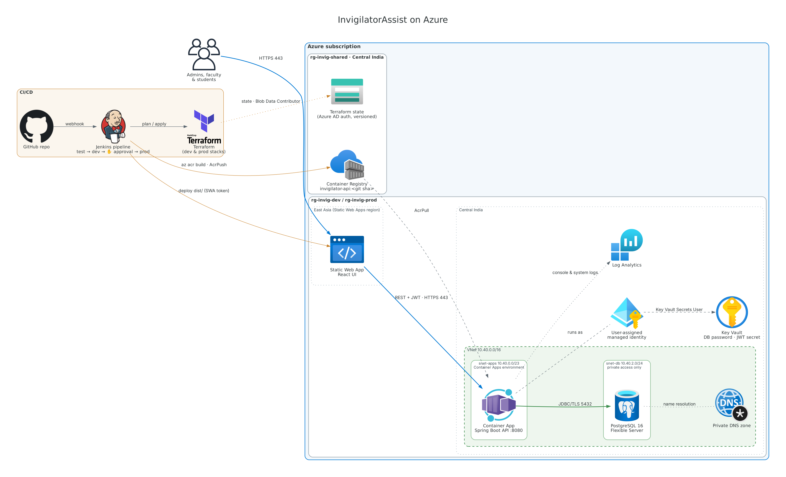
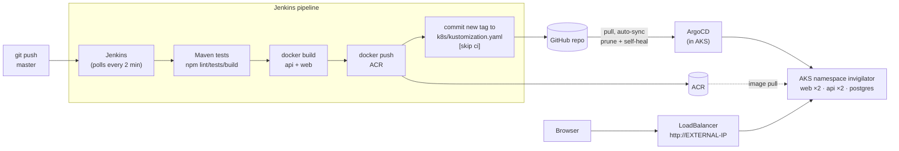
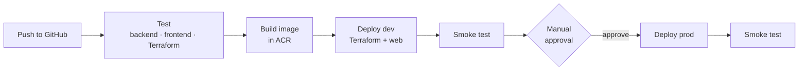

# InvigilatorAssist — exam operations platform

Plans exam sittings, seats students with subjects mixed, assigns invigilators fairly, and lets faculty swap
duties safely. It replaces the original PHP/MySQL prototype, which is kept unchanged in [`legacy/`](legacy).

| Layer | Stack |
| --- | --- |
| API | Java 21, Spring Boot 3.5, Spring Security (JWT), Spring Data JPA, Flyway |
| Database | PostgreSQL 16 (Azure Database for PostgreSQL Flexible Server) |
| Web | React 19, TypeScript, Vite, TanStack Query, React Router |
| Containers | Docker (multi-stage, layered images for API and web) |
| CI/CD | Jenkins (declarative pipeline, `Jenkinsfile`, Jenkins configured as code in `ci/jenkins`) |
| Kubernetes / GitOps | AKS, Kustomize manifests (`k8s/`), ArgoCD auto-sync (`argocd/`) |
| Cloud | Azure Kubernetes Service + Container Registry; alternative stack: Container Apps, Static Web Apps, Key Vault, Log Analytics |
| IaC | Terraform (`infra/`) |



<sub>Regenerate with `python docs/diagrams/architecture.py` (needs `pip install diagrams` and Graphviz).</sub>

## What the new version does

**Admin (exam cell)**
- Imports departments, rooms, faculty, subjects, students and backlog/elective enrollments from CSV.
  Each file is all-or-nothing, and every bad row is reported.
- Schedules exams. Exams that start at the same date and time form a **sitting**.
- Allocates a whole sitting in one transaction:
  - **Smart seating.** Uses the fewest rooms and mixes subjects so neighbours write different papers.
    Students who need an accessible room are seated only in accessible rooms.
    A student with two papers in the same sitting blocks the allocation with a clear message.
  - **Fair invigilators.** Picks the lowest duty load first, spreads duties across departments, and favours
    whoever has gone longest without a duty. It respects quotas and blocked dates, and never assigns
    someone to invigilate a subject they teach.
- Views seat lists per room, prints door sheets (one room per page), and clears and re-runs an allocation.
- A **duty fairness** page shows every faculty member's load against their quota.

**Faculty**
- Sees their upcoming duties and quota.
- Blocks dates they are unavailable.
- **Swaps:** sees only colleagues they can validly swap with (both checked: free at that time, not on leave,
  not teaching a subject in that room). Accepting a swap really exchanges the duties, and stale requests
  on those duties are cancelled.

**Students**
- See their exams with date, time, room, building, floor and seat number.

## What was fixed from the PHP version

| Legacy problem | Now |
| --- | --- |
| SQL injection in every query | JPA/parameterised queries only |
| DB root password committed in `admin.php` | Secrets in Key Vault, read by managed identity. **Rotate that old password if it is used anywhere.** |
| No admin login; students "log in" with only a reg. no; plaintext faculty passwords | JWT auth with ADMIN/FACULTY/STUDENT roles, BCrypt, forced password change on first login |
| Accepting a swap only set `swap.app = 1`; duties never moved | Accept swaps the invigilators atomically, with re-validation |
| Swap details passed in the URL (`faculty3.php?a=…`), forgeable | Server-side checks of ownership and eligibility |
| Swap filter `date != X AND time != Y` excluded valid slots | Real overlap check on date and time ranges |
| No transactions (MyISAM); failures left half-allocated sessions | One transaction per sitting; faculty rows locked during allocation |
| One subject per room, students filled in reg-no order | Subjects interleaved; accessibility respected |
| Elective (`DE`) subjects never seated | `elective` subjects seat only enrolled students |

## Repository layout

```
backend/     Spring Boot API (allocation engine in allocation/engine — pure Java, unit tested)
frontend/    React app
infra/
  bootstrap/ one-time: Terraform state storage + shared container registry
  modules/   network, monitoring, key_vault, postgres, container_app, static_web_app, stack
  envs/      dev and prod roots (same stack, different sizes)
k8s/         Kubernetes manifests (Kustomize): postgres, api ×2, web ×2, LoadBalancer
argocd/      ArgoCD AppProject + Application (auto-sync, prune, self-heal)
ci/          jenkins/ (Jenkins image + configuration as code) · scripts/ (GitOps tag bump, deploy verification)
scripts/     Azure provisioning (ACR + AKS), Jenkins VM, ArgoCD install, verification, teardown
screenshots/ evidence of each pipeline step
tools/       legacy_to_csv.py — converts the old MySQL dump into import CSVs
samples/     demo/ (realistic sample college) and legacy-import/ (converted from legacy/ems.sql)
legacy/      original PHP application, unchanged
Jenkinsfile  CI/CD pipeline: test → Docker build → push to ACR → GitOps commit for ArgoCD
Jenkinsfile.container-apps  alternative pipeline for Azure Container Apps + Terraform
```

## Run it locally

Prerequisites: JDK 21, Maven 3.9, Node 22, Docker.

```bash
docker compose up -d db                                   # PostgreSQL on :5432
cd backend && mvn spring-boot:run -Dspring-boot.run.profiles=dev
cd frontend && npm install && npm run dev                 # http://localhost:5173
```

The `dev` profile creates institution **DEMO** with admin **admin@demo.edu** / **admin12345**.
Sign in, open **Import data**, and upload the files in `samples/demo/` in the order shown.
Download the temporary passwords file after the faculty and students uploads. Then go to
**Schedule**, add exams (e.g. CSE301, ECE301 and ME301 on the same date and time), and click **Allocate**.

API docs: http://localhost:8080/swagger-ui.html

Tests:

```bash
cd backend && mvn verify      # unit tests + Testcontainers integration test (needs Docker)
cd frontend && npm test && npm run lint && npm run build
```

## CI/CD on Kubernetes: Spring Boot → Docker → Jenkins → ACR → ArgoCD → AKS

Every commit to `master` is tested, built into two Docker images, pushed to Azure Container Registry and deployed
to AKS by ArgoCD. The deployment is pull-based: Jenkins never talks to the cluster. It only commits the new image
tag to `k8s/kustomization.yaml`, and ArgoCD, running inside AKS, pulls that change from Git and syncs it.



### What runs where

| Component | Files | Notes |
| --- | --- | --- |
| Spring Boot REST API | `backend/` (Maven, Spring Boot 3.5, Java 21) | `GET /api/health` returns status, version (image tag), pod name and DB state. Actuator probes at `/actuator/health/{liveness,readiness}` |
| Web | `frontend/` (React, served by nginx) | nginx serves the SPA and proxies `/api` to the API Service, so the browser sees one origin |
| Docker | `backend/Dockerfile`, `frontend/Dockerfile`, `.dockerignore` files | Multi-stage builds, BuildKit dependency caches, Spring Boot layered jar, non-root users, OCI labels, `HEALTHCHECK` |
| Registry | Azure Container Registry | Images `invigilator-api` and `invigilator-web`, tagged `<build>-<commit>` and `latest` |
| CI/CD | `Jenkinsfile`, `ci/jenkins/` (Jenkins configured as code), `ci/scripts/` | Test → build → push → GitOps commit → verify |
| Kubernetes | `k8s/` (Kustomize) | Namespace, PostgreSQL StatefulSet + disk, API Deployment ×2 (ClusterIP), web Deployment ×2 (LoadBalancer), ConfigMap, PodDisruptionBudgets |
| GitOps | `argocd/project.yaml`, `argocd/application.yaml` | Auto-sync with prune and self-heal, retries, `CreateNamespace=true` |
| Azure setup (Azure CLI) | `scripts/azure-provision.sh`, `scripts/jenkins-vm.sh`, `scripts/install-argocd.sh`, `scripts/verify.sh`, `scripts/azure-teardown.sh` | Fit the KodeKloud Azure playground limits (existing resource group, 1 node pool, ≤ 2 small nodes, no Container Insights, Standard disks ≤ 128 GB) |
| Infrastructure as code (alternative) | `infra/aks-gitops/` (Terraform) | The same ACR, AKS and Jenkins VM as the scripts, for teams that manage Azure with Terraform. Not needed for the CLI path |

### Secrets: none in Git

| Secret | Where it lives | Created by |
| --- | --- | --- |
| PostgreSQL password | Kubernetes Secret `invigilator-db` | `azure-provision.sh` (random) |
| JWT signing key, demo admin password | Kubernetes Secret `invigilator-app` | `azure-provision.sh` (random) |
| ACR pull credentials | Kubernetes Secret `acr-pull` (only used if AKS can't be attached to ACR) | `azure-provision.sh` |
| ACR push credentials, GitHub token, Jenkins admin password | `ci/jenkins/.env` (git-ignored) → Jenkins credentials `acr-credentials`, `github-credentials` | you / `azure-provision.sh` |
| ArgoCD admin password | Secret `argocd-initial-admin-secret` | ArgoCD install |

### Prerequisites

- A KodeKloud **Azure playground** (or any Azure subscription).
- A GitHub [fine-grained token](https://github.com/settings/personal-access-tokens/new) with **Contents: Read
  and write** on this repository. Jenkins uses it to push the GitOps commit.
- A shell with `az`, `kubectl`, `git`, `ssh` and `openssl`. **Azure Cloud Shell (Bash)** in the Azure portal
  already has all of them, so nothing needs installing on your laptop: `git clone` this repository there and
  run the scripts from it.

Jenkins and Docker need about 10 GB of disk and 4–8 GB of RAM. There are two ways to run them:

- **Recommended:** a small Ubuntu VM in the same Azure subscription (`scripts/jenkins-vm.sh`, step 4).
- Your own machine with Docker Desktop (`ci/jenkins/start.sh`).

Either way Jenkins only needs outbound internet access: it polls GitHub and pushes to ACR, so no webhook is
required.

### Step 1: Run the app locally

On any machine with Docker: your laptop, or the Jenkins VM from step 4 over SSH (the script prints the exact
commands; there, open `http://<vm-ip>:8080` only after allowing the port, or use `curl` in the SSH session).

```bash
docker compose --profile full up --build        # PostgreSQL + API (:8080) + web (:3000)
curl http://localhost:8080/api/health           # {"status":"UP",...,"database":"UP"}
open http://localhost:3000                      # log in as admin@demo.edu / admin12345
```

Or run the API with Maven: `docker compose up -d db`, then `cd backend && mvn spring-boot:run -Dspring-boot.run.profiles=dev`.

### Step 2: Create ACR and AKS

```bash
az login                                        # with the KodeKloud playground user
bash scripts/azure-provision.sh
```

The script:

1. Finds the playground's resource group.
2. Creates an ACR with the admin user enabled.
3. Creates a 2-node AKS cluster. It tries `Standard_D2s_v3`, then `Standard_B2s`, `Standard_K8S2_v1` and
   `Standard_D4s_v3` until one passes the playground policy. Override with `NODE_SIZE=...`.
4. Gets kubectl credentials, tries `--attach-acr` and falls back to a pull Secret.
5. Creates the namespace and the random Secrets.
6. Writes the ACR credentials into `ci/jenkins/.env`.
7. Points `k8s/kustomization.yaml` at your registry.

Commit and push that change when the script asks:

```bash
git add k8s/kustomization.yaml && git commit -m "k8s: use this environment's ACR" && git push
```

**Alternative: Terraform.** `infra/aks-gitops/` creates the same ACR, AKS and Jenkins VM with Terraform, keeping
its state in Azure Storage. It is optional, and the scripts above do not need it. See
`infra/aks-gitops/README.md` for how to run it.

### Step 3: Build and push the images by hand (first time)

```bash
ACR=$(az acr list --query '[0].loginServer' -o tsv)
az acr login --name "${ACR%%.*}"
docker build --platform linux/amd64 -t "$ACR/invigilator-api:latest" --build-arg APP_VERSION=manual backend
docker build --platform linux/amd64 -t "$ACR/invigilator-web:latest" --build-arg APP_VERSION=manual frontend
docker images | grep invigilator
docker push "$ACR/invigilator-api:latest"
docker push "$ACR/invigilator-web:latest"
az acr repository list -n "${ACR%%.*}" -o table
```

`--platform linux/amd64` matters on Apple Silicon Macs, because AKS nodes are amd64.

### Step 4: Start Jenkins and run the pipeline

Add `JENKINS_ADMIN_PASSWORD`, `GITHUB_USER` and `GITHUB_TOKEN` to `ci/jenkins/.env` (it already has `ACR_*`).
Then use one of:

```bash
bash scripts/jenkins-vm.sh            # recommended: Ubuntu VM with Docker + Jenkins, prints http://<vm-ip>:8081
# or, on a machine with Docker Desktop:
cd ci/jenkins && bash start.sh        # http://localhost:8081
```

`jenkins-vm.sh` tries `Standard_D2s_v3`, then `Standard_B2s`, until one passes the playground policy. It uses a
64 GB Standard HDD disk, because the playground rejects Premium disks and disks over 128 GB. It adds 4 GB of swap for the Maven and npm builds, copies `.env` over SSH so the secrets never go into
VM metadata, and opens port 8081. Set `ALLOW_FROM=<your-ip>` to limit who can reach Jenkins.

Jenkins starts with the plugins, the two credentials and the **InvigilatorAssist CI/CD** pipeline job already
created from `ci/jenkins/casc.yaml`. There is no setup wizard. Click **Build Now** for the first run. After that,
Jenkins polls GitHub every 2 minutes and builds every new commit automatically.

Pipeline stages: **Checkout → Build & test (Backend Maven ‖ Frontend npm) → Docker build → Push to ACR →
Update GitOps manifests → Verify deployment**. The GitOps commit is marked `[skip ci]`. Jenkins sees it,
records the build as *Not built* and does nothing, so the pipeline never loops.

Jenkins agent requirements (if you use your own Jenkins instead): `git`, `mvn` with JDK 21, Node 22, and the
Docker CLI with buildx. Add the global env var `ACR_LOGIN_SERVER` and the credentials `acr-credentials` and
`github-credentials`, then create a Pipeline job from SCM with script path `Jenkinsfile`.

### Step 5: Deploy to Kubernetes

```bash
git pull                                        # get Jenkins' tag commit
kubectl apply -k k8s/                           # first deploy by hand (ArgoCD takes over in step 6)
kubectl -n invigilator rollout status deploy/invigilator-api --timeout=5m
kubectl -n invigilator get pods -o wide         # 2 api + 2 web + 1 postgres, all Running
kubectl -n invigilator get svc                  # invigilator-web has an EXTERNAL-IP
```

### Step 6: GitOps with ArgoCD

```bash
bash scripts/install-argocd.sh
```

This installs ArgoCD, registers `argocd/application.yaml` (auto-sync, prune, self-heal) and gives the ArgoCD UI
a public IP. It prints the URL and the command that shows the admin password. From now on, Git is the only way
to change the deployment:

```bash
kubectl -n invigilator scale deploy invigilator-api --replicas=1   # manual drift...
kubectl -n invigilator get deploy invigilator-api -w               # ...ArgoCD self-heal puts it back to 2
```

Put the app URL into `ci/jenkins/.env` as `APP_URL=http://<EXTERNAL-IP>` and run `bash start.sh` again. The
pipeline's **Verify deployment** stage then waits until `/api/health` reports the version it just built.

### Step 7: Verify end to end

```bash
bash scripts/verify.sh       # timestamped: nodes, pods, services, image tags, ArgoCD sync status, /api/health
```

- Homepage: `http://<EXTERNAL-IP>/`. Log in as `admin@demo.edu` with the password from
  `kubectl -n invigilator get secret invigilator-app -o jsonpath='{.data.admin-password}' | base64 -d`.
- Health: `http://<EXTERNAL-IP>/api/health`. Refresh it a few times: `instance` alternates between the two API pods.
- Full loop: change something (for example the `service` text in `HealthController`), commit and push. Within
  a few minutes Jenkins builds `N-<sha>` and pushes to ACR, ArgoCD syncs, and `/api/health` shows the new
  `version`.

### Troubleshooting

| Symptom | Fix |
| --- | --- |
| `RequestDisallowedByPolicy` creating AKS | Use an allowed size: `NODE_SIZE=Standard_B2s bash scripts/azure-provision.sh` |
| `RequestDisallowedByPolicy` for the Jenkins VM disk | The playground allows only non-Premium disks up to 128 GB. `jenkins-vm.sh` already asks for `Standard_LRS`; if an earlier attempt left a failed VM, run `az vm delete -g <rg> -n vm-jenkins --yes` first |
| Pods `ImagePullBackOff` | `kubectl -n invigilator describe pod <pod>`. Check that the `newName` registry in `k8s/kustomization.yaml` is your ACR and that the tag exists (`az acr repository show-tags -n <acr> --repository invigilator-api`). Re-run `azure-provision.sh` to refresh `acr-pull` |
| `exec format error` in pods | An image was built for arm64. Rebuild it with `--platform linux/amd64` (the Jenkinsfile already does this) |
| API pods `Pending` | The nodes are full: `kubectl describe pod`. Make sure `ARGOCD_MINIMAL=true` (default), or use `Standard_D2s_v3` nodes |
| Jenkins `permission denied ... docker.sock` | Run `DOCKER_GID=$(stat -c %g /var/run/docker.sock) bash start.sh` |
| ArgoCD `OutOfSync` after the playground was recreated | The registry name changed: re-run `azure-provision.sh` and push the updated `k8s/kustomization.yaml` |

Clean up with `bash scripts/azure-teardown.sh`, and `az vm delete -g <rg> -n vm-jenkins --yes` for the Jenkins VM. KodeKloud playgrounds also expire on their own.

## Migrating data from the PHP app

```bash
python3 tools/legacy_to_csv.py legacy/ems.sql out/ --email-domain yourcollege.edu
```

This produces the six import CSVs. Old passwords are **not** migrated; everyone receives a temporary password.
The old `teacher` table has no emails, so placeholder addresses are generated. Correct them in
`faculty.csv` before importing. The old rooms have capacity 3 (test data), so set real capacities.

## Alternative deployment: Azure Container Apps + Terraform

The original serverless deployment is still available. It uses `Jenkinsfile.container-apps`, so set that as
the job's script path.

### 1. One-time setup (a subscription Owner)

1. Create a service principal for Jenkins. It needs **Contributor** and **Role Based Access Control
   Administrator** (or User Access Administrator) on the subscription, because Terraform creates role
   assignments for the app's managed identity.
2. Run the bootstrap:
   ```bash
   cd infra/bootstrap
   terraform init
   terraform apply -var deployer_object_id=$(az ad sp show --id <appId> --query id -o tsv)
   ```
   Note the outputs: `state_storage_account_name` and `acr_name`.
3. Put `acr_name` into `infra/envs/dev/terraform.tfvars` and `infra/envs/prod/terraform.tfvars`.

### 2. Jenkins

Plugins: Pipeline, Git, Credentials Binding, JUnit, NodeJS, Timestamper, Workspace Cleanup.
The agent with label `linux` needs Docker, Azure CLI and Terraform ≥ 1.9.
Configure the tools `jdk21`, `maven3` and `node22`.

Credentials:

| ID | Type | Value |
| --- | --- | --- |
| `azure-sp` | Username with password | SP appId / client secret |
| `azure-tenant-id` | Secret text | tenant ID |
| `azure-subscription` | Secret text | subscription ID |
| `tf-backend-account` | Secret text | `state_storage_account_name` from bootstrap |



Create a Multibranch Pipeline on this repository with script path `Jenkinsfile.container-apps`. On `main`, the pipeline runs these steps:

1. Tests
2. Builds the image in ACR, tagged with the commit SHA
3. Runs `terraform apply` for dev
4. Deploys the web app
5. Smoke-tests
6. Waits for approval
7. Repeats steps 3–5 for prod

Other branches run tests and Terraform checks only.

### 3. After the first deploy

- Create each institution and its first admin, the same two rows the dev seeder creates. A small admin CLI or
  operator endpoint for this is on the roadmap.
- Add the college's domain to `extra_cors_origins` and attach it to the Static Web App.

### Environment sizes

| | dev | prod |
| --- | --- | --- |
| API | 0.5 vCPU / 1 GiB, scales to zero | 1 vCPU / 2 GiB, min 1 replica, max 6 |
| PostgreSQL | Burstable B1ms, 7-day backups | General Purpose D2ds_v5, zone-redundant HA, geo backups, 35 days |
| Static Web App | Free | Standard |
| Key Vault | purge protection off | purge protection on |

## Verification status of this branch

- Allocation engine: 15 unit tests pass, covering seating, subject mixing, accessibility, quotas, fairness and conflicts.
- Frontend: type-checks, lints clean, builds, and its unit tests pass.
- Terraform: all files parse, and every module call matches its module's variables and outputs.
  `terraform validate` runs in the Jenkins "Terraform checks" stage.
- Spring Boot application, the new `/api/health` endpoint and its unit test, and the integration test:
  **written but not yet compiled.** The environment these branches were produced in had no access to Maven
  Central. The first `docker compose --profile full up --build` or Jenkins run compiles them, so run one of
  those before anything else.
- CI/CD on Kubernetes: the manifests and ArgoCD files parse as YAML, and the shell scripts pass `shellcheck`.
  The GitOps tag bump and the deployment check were tested against a local Git remote and a stub server.
  Docker images, Jenkins, AKS and ArgoCD were not run there: no Docker daemon or Azure access.

## Roadmap (from the product plan)

1. Operator onboarding for new institutions (multi-tenant signup)
2. Swap marketplace: open board, approval rules (HOD / exam cell), emergency reserve pool
3. Invigilator mobile check-in (React Native, QR/geofence) and hall-ticket QR attendance
4. Remuneration report and payroll export
5. Notifications (email / WhatsApp), live control-room dashboard, incident reporting
6. Timetable generation with a constraint solver
