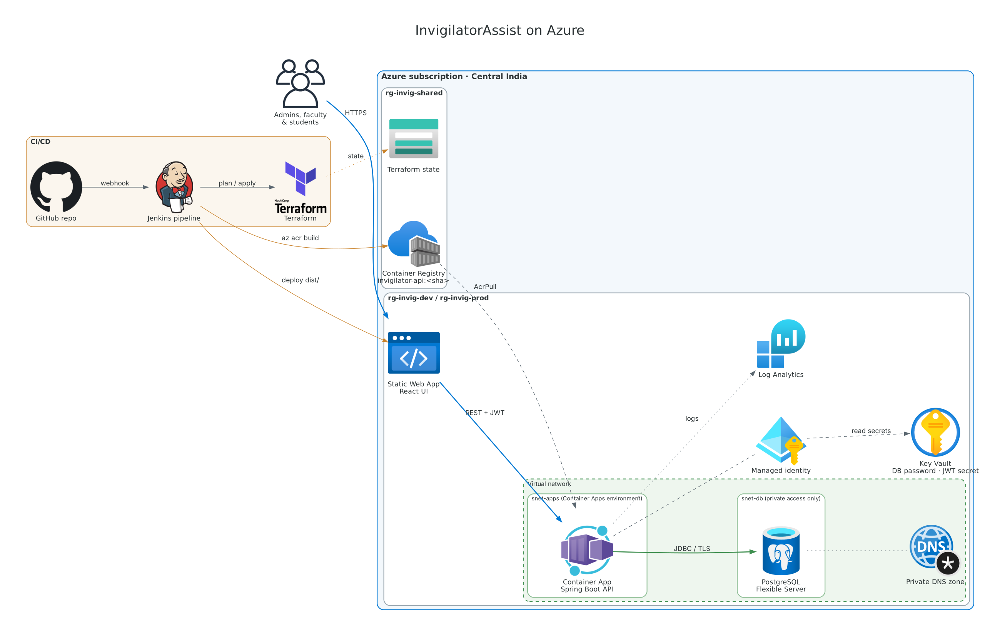
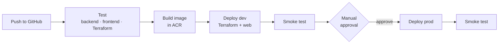

# InvigilatorAssist — exam operations platform

Plans exam sittings, seats students with subjects mixed, assigns invigilators fairly, and lets faculty swap
duties safely. It replaces the original PHP/MySQL prototype, which is kept unchanged in [`legacy/`](legacy).

| Layer | Stack |
| --- | --- |
| API | Java 21, Spring Boot 3.5, Spring Security (JWT), Spring Data JPA, Flyway |
| Database | PostgreSQL 16 (Azure Database for PostgreSQL Flexible Server) |
| Web | React 19, TypeScript, Vite, TanStack Query, React Router |
| CI/CD | Jenkins (declarative pipeline, `Jenkinsfile`) |
| Cloud | Azure Container Apps, Static Web Apps, Key Vault, Container Registry, Log Analytics |
| IaC | Terraform (`infra/`) |



<sub>Regenerate with `python docs/diagrams/architecture.py` (needs `pip install diagrams` and Graphviz).</sub>

## What the new version does

**Admin (exam cell)**
- Imports departments, rooms, faculty, subjects, students and backlog/elective enrollments from CSV.
  Each file is all-or-nothing, and every bad row is reported.
- Schedules exams. Exams that start at the same date and time form a **sitting**.
- Allocates a whole sitting in one transaction:
  - **Smart seating.** Uses the fewest rooms and mixes subjects so neighbours write different papers.
    Students who need an accessible room are seated only in accessible rooms.
    A student with two papers in the same sitting blocks the allocation with a clear message.
  - **Fair invigilators.** Picks the lowest duty load first, spreads duties across departments, and favours
    whoever has gone longest without a duty. It respects quotas and blocked dates, and never assigns
    someone to invigilate a subject they teach.
- Views seat lists per room, prints door sheets (one room per page), and clears and re-runs an allocation.
- A **duty fairness** page shows every faculty member's load against their quota.

**Faculty**
- Sees their upcoming duties and quota.
- Blocks dates they are unavailable.
- **Swaps:** sees only colleagues they can validly swap with (both checked: free at that time, not on leave,
  not teaching a subject in that room). Accepting a swap really exchanges the duties, and stale requests
  on those duties are cancelled.

**Students**
- See their exams with date, time, room, building, floor and seat number.

## What was fixed from the PHP version

| Legacy problem | Now |
| --- | --- |
| SQL injection in every query | JPA/parameterised queries only |
| DB root password committed in `admin.php` | Secrets in Key Vault, read by managed identity. **Rotate that old password if it is used anywhere.** |
| No admin login; students "log in" with only a reg. no; plaintext faculty passwords | JWT auth with ADMIN/FACULTY/STUDENT roles, BCrypt, forced password change on first login |
| Accepting a swap only set `swap.app = 1`; duties never moved | Accept swaps the invigilators atomically, with re-validation |
| Swap details passed in the URL (`faculty3.php?a=…`), forgeable | Server-side checks of ownership and eligibility |
| Swap filter `date != X AND time != Y` excluded valid slots | Real overlap check on date and time ranges |
| No transactions (MyISAM); failures left half-allocated sessions | One transaction per sitting; faculty rows locked during allocation |
| One subject per room, students filled in reg-no order | Subjects interleaved; accessibility respected |
| Elective (`DE`) subjects never seated | `elective` subjects seat only enrolled students |

## Repository layout

```
backend/     Spring Boot API (allocation engine in allocation/engine — pure Java, unit tested)
frontend/    React app
infra/
  bootstrap/ one-time: Terraform state storage + shared container registry
  modules/   network, monitoring, key_vault, postgres, container_app, static_web_app, stack
  envs/      dev and prod roots (same stack, different sizes)
tools/       legacy_to_csv.py — converts the old MySQL dump into import CSVs
samples/     demo/ (realistic sample college) and legacy-import/ (converted from legacy/ems.sql)
legacy/      original PHP application, unchanged
Jenkinsfile  CI/CD pipeline
```

## Run it locally

Prerequisites: JDK 21, Maven 3.9, Node 22, Docker.

```bash
docker compose up -d db                                   # PostgreSQL on :5432
cd backend && mvn spring-boot:run -Dspring-boot.run.profiles=dev
cd frontend && npm install && npm run dev                 # http://localhost:5173
```

The `dev` profile creates institution **DEMO** with admin **admin@demo.edu** / **admin12345**.
Sign in, open **Import data**, and upload the files in `samples/demo/` in the order shown.
Download the temporary passwords file after the faculty and students uploads. Then go to
**Schedule**, add exams (e.g. CSE301, ECE301 and ME301 on the same date and time), and click **Allocate**.

API docs: http://localhost:8080/swagger-ui.html

Tests:

```bash
cd backend && mvn verify      # unit tests + Testcontainers integration test (needs Docker)
cd frontend && npm test && npm run lint && npm run build
```

## Migrating data from the PHP app

```bash
python3 tools/legacy_to_csv.py legacy/ems.sql out/ --email-domain yourcollege.edu
```

This produces the six import CSVs. Old passwords are **not** migrated; everyone receives a temporary password.
The old `teacher` table has no emails, so placeholder addresses are generated. Correct them in
`faculty.csv` before importing. The old rooms have capacity 3 (test data), so set real capacities.

## Deploying to Azure

### 1. One-time setup (a subscription Owner)

1. Create a service principal for Jenkins. It needs **Contributor** and **Role Based Access Control
   Administrator** (or User Access Administrator) on the subscription, because Terraform creates role
   assignments for the app's managed identity.
2. Run the bootstrap:
   ```bash
   cd infra/bootstrap
   terraform init
   terraform apply -var deployer_object_id=$(az ad sp show --id <appId> --query id -o tsv)
   ```
   Note the outputs: `state_storage_account_name` and `acr_name`.
3. Put `acr_name` into `infra/envs/dev/terraform.tfvars` and `infra/envs/prod/terraform.tfvars`.

### 2. Jenkins

Plugins: Pipeline, Git, Credentials Binding, JUnit, NodeJS, Timestamper, Workspace Cleanup.
The agent with label `linux` needs Docker, Azure CLI and Terraform ≥ 1.9.
Configure the tools `jdk21`, `maven3` and `node22`.

Credentials:

| ID | Type | Value |
| --- | --- | --- |
| `azure-sp` | Username with password | SP appId / client secret |
| `azure-tenant-id` | Secret text | tenant ID |
| `azure-subscription` | Secret text | subscription ID |
| `tf-backend-account` | Secret text | `state_storage_account_name` from bootstrap |



Create a Multibranch Pipeline on this repository. On `main`, the pipeline runs these steps:

1. Tests
2. Builds the image in ACR, tagged with the commit SHA
3. Runs `terraform apply` for dev
4. Deploys the web app
5. Smoke-tests
6. Waits for approval
7. Repeats steps 3–5 for prod

Other branches run tests and Terraform checks only.

### 3. After the first deploy

- Create each institution and its first admin, the same two rows the dev seeder creates. A small admin CLI or
  operator endpoint for this is on the roadmap.
- Add the college's domain to `extra_cors_origins` and attach it to the Static Web App.

### Environment sizes

| | dev | prod |
| --- | --- | --- |
| API | 0.5 vCPU / 1 GiB, scales to zero | 1 vCPU / 2 GiB, min 1 replica, max 6 |
| PostgreSQL | Burstable B1ms, 7-day backups | General Purpose D2ds_v5, zone-redundant HA, geo backups, 35 days |
| Static Web App | Free | Standard |
| Key Vault | purge protection off | purge protection on |

## Verification status of this branch

- Allocation engine: 15 unit tests pass, covering seating, subject mixing, accessibility, quotas, fairness and conflicts.
- Frontend: type-checks, lints clean, builds, and its unit tests pass.
- Terraform: all files parse, and every module call matches its module's variables and outputs.
  `terraform validate` runs in the Jenkins "Terraform checks" stage.
- Spring Boot application and the integration test: **written but not yet compiled in CI.** The environment
  this branch was produced in had no access to Maven Central. Run `mvn verify` first.

## Roadmap (from the product plan)

1. Operator onboarding for new institutions (multi-tenant signup)
2. Swap marketplace: open board, approval rules (HOD / exam cell), emergency reserve pool
3. Invigilator mobile check-in (React Native, QR/geofence) and hall-ticket QR attendance
4. Remuneration report and payroll export
5. Notifications (email / WhatsApp), live control-room dashboard, incident reporting
6. Timetable generation with a constraint solver
